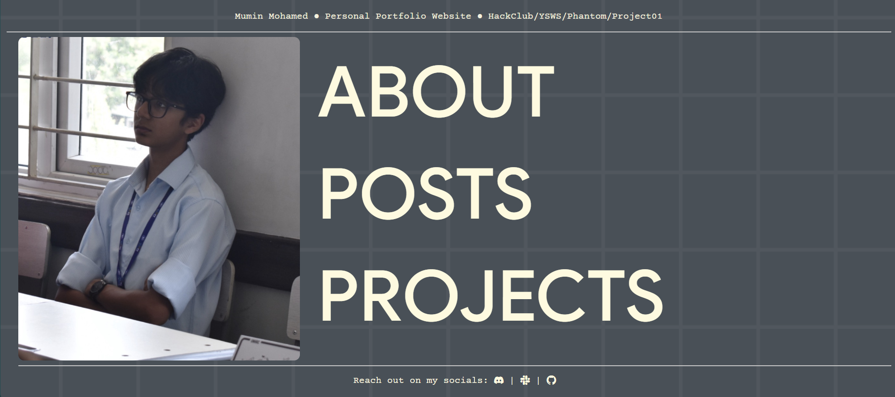
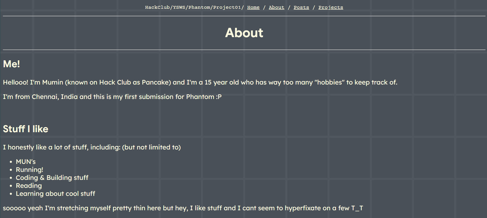
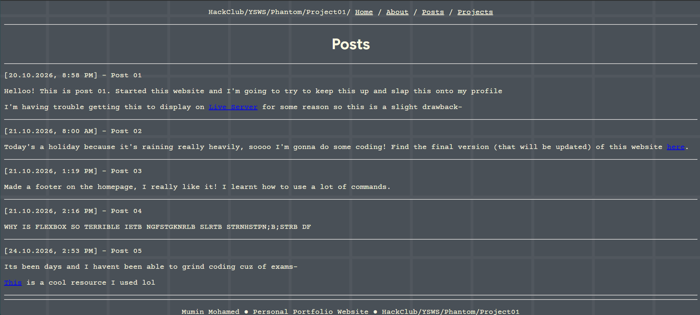

# PersonalPortfolio
### Personal Portfolio HTML Website for YSWS-Phantom!

## I. Basic Info

- This is a Peronal Portfolio website that I made to display on my socials, it's a website that showcases stuff about me and what I did. I also added an Error 404 page (try changing the link from https://muminspersonalportfolio.vercel.app/index.html to some gibberish like https://muminspersonalportfolio.vercel.app/reujkdvfds.html)

## II. Tech Stack

- This is a super basic project lol (I'm a beginner :P)
- I used HTML and CSS for this website, and I plan on adding a bit of JS soon!
- Also learnt how to use VSCode and Github when I made this!

## III. Problems

Honestly, the main problems I encountered were flexbox, flexbox, flexbox (did I forget to mention, flexbox) HONESTLY ITS SUCH A PAIN TO FORMAT but it was cool once I got a basic hang of it.

## IV. Demo Link

https://muminspersonalportfolio.vercel.app/

## V. Images

## VI. AI Disclosure

Minimal AI was used here - I only used it when I didnt know what the HTML tags were or when there was an issue with formatting. Even then I just asked for the generic tag / css command and replicated it with trial and error lol

